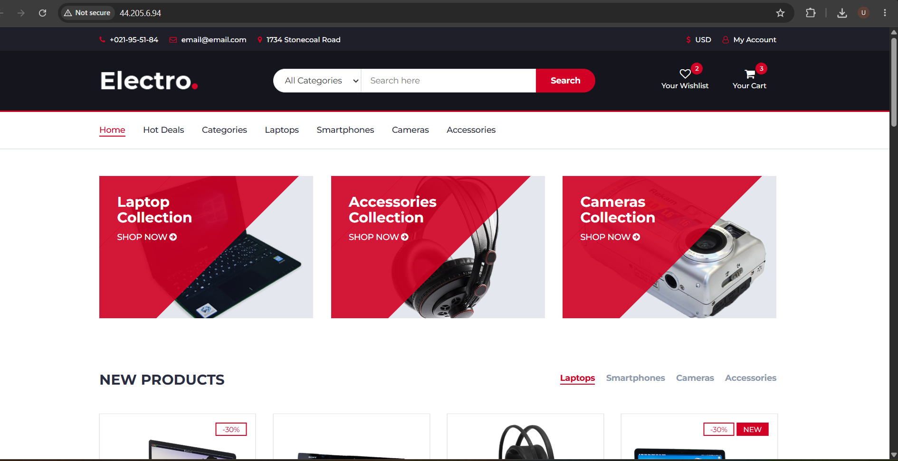

# Electro E-Commerce Website Deployment on AWS EC2 (Windows AMI + IIS)

## Project Overview

This project demonstrates deploying a website on an **AWS EC2 instance running a Windows AMI**, using **Internet Information Services (IIS)** as the web server. The deployed website is an electronics e-commerce storefront named **Electro**.

## Deployment Architecture

- **Cloud platform:** Amazon Web Services (AWS)
- **Compute service:** Amazon EC2
- **Operating system:** Windows Server AMI
- **Web server:** Internet Information Services (IIS)
- **Access method:** Web browser over HTTP
- **Website content:** Static website files (HTML, CSS, JavaScript, and assets, as applicable)

## Website Screenshot

The screenshot below shows the website after deployment.



## Deployment Steps

1. **Launch an EC2 instance**
   - Open the AWS Management Console and navigate to **EC2**.
   - Launch an instance using a suitable Windows Server AMI.
   - Configure the instance type and key pair.

2. **Configure the security group**
   - Allow **HTTP (TCP port 80)** from the required client IP ranges.
   - Allow **RDP (TCP port 3389)** only from your trusted IP address for administration.
   - Avoid opening administrative ports to the entire internet.

3. **Connect to Windows Server**
   - Connect to the instance using Remote Desktop Protocol (RDP).
   - Retrieve and decrypt the Windows administrator password using the EC2 key pair, if required.

4. **Install IIS**
   - Open **Server Manager**.
   - Select **Add Roles and Features**.
   - Install **Web Server (IIS)** and the required role services.
   - Confirm IIS is running by opening `http://localhost`(http://44.205.6.94/#) on the instance.

5. **Deploy the website files**
   - Copy the website files to the IIS default web root, typically:
     `C:\inetpub\wwwroot`
   - Ensure the main page is named `index.html` or configure the appropriate default document in IIS.
   - Replace the default IIS page with the website files.

6. **Verify the deployment**
   - Confirm the EC2 instance is running and the security group permits HTTP traffic.
   - Open the instance's public IPv4 address in a browser using `http://<EC2-Public-IPv4>`.
   - Check that the page, images, styles, and links load correctly.

## Troubleshooting

- **Website does not open:** Verify the instance status, public IPv4 address, security group inbound rule for TCP port 80, and Windows Firewall settings.
- **IIS default page appears:** Confirm the website files are in the IIS web root and the default document is configured correctly.
- **Images or CSS are missing:** Check relative file paths and make sure all assets were copied to the server.
- **Connection times out:** Check network configuration, security group rules, Windows Firewall, and whether IIS is running.

## Security Notes

- Restrict RDP access to your own trusted IP address.
- Use HTTPS with a valid TLS certificate for production deployments.
- Do not publish administrator credentials, private keys, or other secrets in this repository.
- Consider using a DNS name and a managed certificate for a production site.

## What I Learned

- Launching and configuring a Windows EC2 instance.
- Installing and configuring IIS.
- Hosting website files on a Windows web server.
- Configuring network access and validating a cloud-hosted website.

## Repository Structure

```text
.
├── README.md
└── images/
    └── website-screenshot.png
```

## Note

Update this README with your actual AWS Region, Windows Server version, instance details, and deployment-specific configuration if needed. Do not include private credentials or sensitive infrastructure details.
